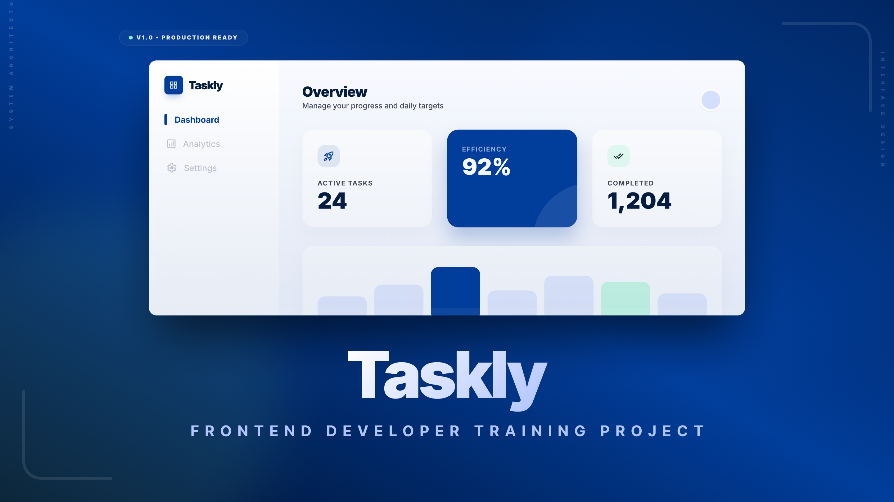

# Tasks Management Frontend Training Project

Welcome to the **Tasks Management** project! This repository is specifically designed for frontend developers for training purposes. 

This project will help you improve your skills by simulating a real-world project environment. Just like on actual projects, you are provided with a complete set of resources including a Figma design file, a board with tasks for each feature, and comprehensive API documentation.

## 🚀 Project Resources

- **Figma Design:** [View Design](https://www.figma.com/design/zAwYa5nDWE2YirHYPpNabw/Tasks-Management?node-id=0-1&t=L7Jf026Stu5qCTd2-1)
- **Task Board:** [List of tasks to do](https://www.notion.so/ee8ac15769ca83b790a281e6aca5682a?v=fb4ac15769ca8211827708b963b3b7fc)
- **Backend Schema:** [View the Supabase schema](schema.sql) (fresh-project setup; see the API documentation before applying it).
- **Invitation Edge Function:** [View send-invite-email](supabase/functions/send-invite-email/index.ts).
- **Backend Setup:** Follow the [API documentation](tasks_api_docs.md) for the Dashboard-only Supabase setup.
- **API Documentation:** [View API Docs](tasks_api_docs.md)
- **APIDog Documentation:** [View APIDog Docs](https://mr89tdrc7j.apidog.io/)

## 🛠️ Tools Included

- **Postman Collection:** You can find the Postman collection directly in this repository to easily test and explore the available APIs.

## 📬 Contact

If you have any questions or need further assistance, feel free to reach out:

- **Email:** [mahmoud.taha.dev@gmail.com](mailto:mahmoud.taha.dev@gmail.com)
- **LinkedIn:** [Mahmoud Taha](https://www.linkedin.com/in/mahmoud-taha-dev/)
